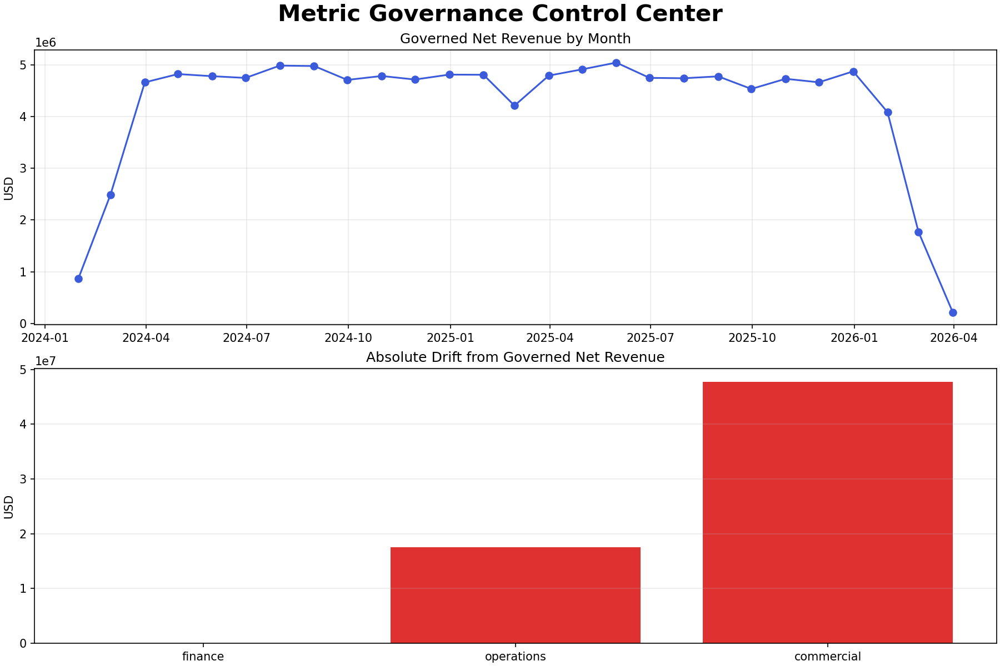
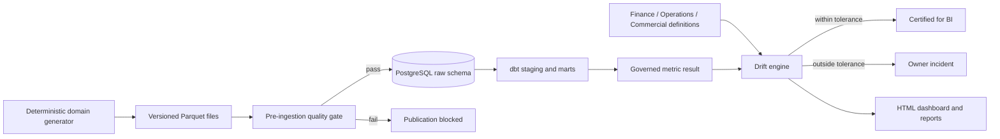

# Semantic Layer & Metrics Governance

[](https://github.com/anandh-data/semantic-layer-metrics-governance/actions)

An executed analytics-engineering project that keeps mortgage, title, escrow, finance, and Power BI reporting on the same metric definitions.



## Business problem

Finance recognizes revenue from posted ledger events and refunds. Operations estimates revenue from closed order value. Commercial counts open pipeline as revenue. All three teams call the result “net revenue,” so leadership receives incompatible numbers.

This platform creates one versioned definition, calculates it from governed warehouse facts, compares every team result, and blocks BI certification when drift exceeds policy.

## Executed result

The committed run processed actual generated project data:

| Result | Value |
|---|---:|
| Public CFPB HMDA records | 2,800,000 |
| Orders | 50,000 |
| Escrow events | 129,171 |
| Finance transactions | 39,484 |
| Total records processed | 3,018,655 |
| Governed KPIs | 25 |
| Source quality checks | 15 passed, 0 failed |
| dbt nodes/tests | 27 passed, 0 failed |
| Power BI DAX measures reconciled | 25 of 25 |
| Superseded definitions resolved | 3 |
| Denial-rate understatement found | 31.68% |
| Governed net revenue | $114,211,972.92 |
| Finance drift | 0.0% — certified |
| Operations drift | 15.3% — blocked |
| Commercial drift | 41.8% — blocked |

Evidence: [pipeline summary](reports/pipeline-summary.json), [DAX reconciliation](reports/dax-reconciliation-results.json), [quality report](reports/data-quality-report.html), and [dbt execution log](logs/dbt-build.log).

## Why this data

The mortgage component uses the CFPB's fixed 2017 nationwide HMDA all-records file. The pipeline selects 2.8 million positions systematically across all 14,285,496 published rows, preventing the outcome bias produced by taking a contiguous block. The archive is public, privacy-modified, and documented by the CFPB.

The title, escrow, and finance component contains 218,655 deterministic fictional records because equivalent employer/customer operational data cannot be published. Together, the two sources provide a real public mortgage workload and a relational operational model suitable for metric-governance testing. See [HMDA source and selection](docs/hmda-source.md).

The fixed seed and [SHA-256 manifest](data/manifests/raw-data-manifest.json) make every source file reproducible and auditable.

## Architecture



## Technology stack

| Layer | Technology |
|---|---|
| Data generation | Python, pandas |
| File storage | Apache Parquet, Snappy compression |
| Warehouse | PostgreSQL 14 |
| Transformation | dbt Core 1.11, dbt-postgres |
| Governance | 25-metric registry, owners, approvals, change history, and thresholds |
| Quality | Python gates, PostgreSQL constraints, dbt tests |
| Reporting | Power BI DAX definitions, HTML, JSON, Matplotlib |
| Automation | Make, GitHub Actions |
| Container option | Docker Compose |

## Repository structure

```text
configs/       pipeline and drift policy
dashboard/     generated interactive HTML dashboard
data/          executed raw/processed Parquet and checksums
db/            PostgreSQL DDL and versioned migrations
dbt/           sources, staging, intermediate, marts, and tests
docs/          architecture, catalog, testing, deployment, ADRs, runbooks
logs/          sanitized real pipeline and dbt execution logs
pipelines/     executable end-to-end orchestration
registry/      governed KPI definitions and owners
bi/            governed and superseded Power BI DAX measures
reports/       generated quality, drift, and run evidence
screenshots/   dashboard output produced by the pipeline
scripts/       isolated local PostgreSQL lifecycle scripts
sql/           source validation and competing team calculations
src/           generator, ingestion, validation, drift, reports, and CLI
tests/         unit, integration, end-to-end, and failure-injection suites
```

## Run the complete project

Prerequisites: Python 3.11+, PostgreSQL utilities, dbt with PostgreSQL adapter, Make, and the official CFPB archive referenced in `docs/hmda-source.md`.

```bash
make local-db-start
make hmda
make pipeline
make integration-test
make test
make local-db-stop
```

`make pipeline` regenerates all committed data, logs, reports, dashboard output, and the screenshot from one execution.

For a container database:

```bash
cp .env.example .env
docker compose up -d --wait
docker compose run --rm pipeline
```

Change the local development password before exposing any service.

## Metric governance

The registry contains 17 HMDA metrics and eight title/escrow/finance metrics. Every definition has a version, owner, effective date, grain, and approval record. The three corrected definitions remain in the change history and the superseded DAX file for auditability.

See the [full metric catalog](docs/metric-catalog.md) and machine-readable [registry](registry/metrics.json).

## Reliability and controls

- Deterministic data version and file hashes
- Primary/foreign keys and domain constraints
- Pre-ingestion schema, uniqueness, relationship, and value checks
- 15 dbt source/model tests
- 15 pre-ingestion quality checks
- 25 dbt-governed KPI outputs reconciled to 25 DAX measures
- Three superseded formulas retained as audit evidence
- Safe expression parser—no arbitrary functions or built-ins
- Metric-specific absolute and relative drift thresholds
- Failure injection proving duplicate orders block publication
- Structured JSON Lines audit log
- Reproducible generated reports linked to one run ID and code revision

## Documentation

- [Business problem](docs/business-problem.md)
- [Architecture](docs/architecture.md)
- [Data dictionary](docs/data-dictionary.md)
- [Metric catalog](docs/metric-catalog.md)
- [Testing strategy](docs/testing-strategy.md)
- [Deployment guide](docs/deployment-guide.md)
- [Metric drift runbook](docs/runbooks/metric-drift.md)
- [Interview explanation](docs/interview-explanation.md)
- [HMDA source and selection](docs/hmda-source.md)
- [Synthetic operational-data decision](docs/adrs/001-synthetic-domain-data.md)

## Security and scope

The HMDA records are public and modified by the CFPB to protect privacy. All title, escrow, and finance entities are fictional. No FNF, employer, customer, or private personal data is included. Large source files, secrets, and the local database cluster are ignored. See [SECURITY.md](SECURITY.md).

The PostgreSQL/dbt pipeline was executed locally. Docker Compose is an alternative packaging path; the README does not claim that container path was executed on this machine.

## License

MIT
