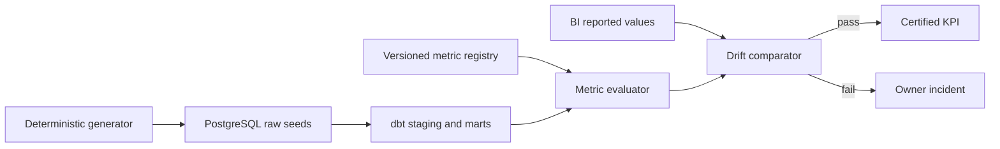

# Semantic Layer & Metric Governance Hub

[](https://github.com/anandh-analytics/semantic-metric-governance/actions)

An executable governance platform for preventing Finance, Operations, and BI teams from publishing different answers for the same KPI.

## Business problem

Teams often calculate “revenue,” “closed orders,” and “turnaround time” with different filters or grains. The disagreement is usually discovered in a leadership meeting, after decisions and reports have already used inconsistent numbers.

## Solution

This repository creates one version-controlled definition for each KPI, computes it through dbt, and compares independently reported BI values against the governed result. Drift fails the certification gate and links the result to a named owner and metric version.

## Data selection

Purpose-built synthetic data models a fictional orders, escrow, and finance organization. It is appropriate because metric disagreement is an organizational rules problem—not a public-data exploration problem. The generator creates safe, deterministic records at configurable scale; no employer or customer data is used.

## Architecture



## Repository map

| Path | Responsibility |
|---|---|
| `data_generator/` | Reproducible orders, escrow, and finance records |
| `dbt/` | Staging, intermediate, marts, tests, and documentation |
| `registry/metrics.json` | KPI meaning, formula, owner, and version |
| `src/metric_hub/` | Safe evaluation and BI drift gate |
| `infra/postgres/` | Database bootstrap and governance audit schema |
| `tests/` | Unit and integration test boundaries |
| `docs/` | Data dictionary, ADRs, architecture, and incident runbooks |

## Quick verification (no Docker)

```bash
make test
make demo
```

The demo intentionally supplies a wrong BI value. A correct gate detects the drift and exits non-zero; the Make target treats that expected failure as success.

## Full local stack

Prerequisites: Docker Compose, Python 3.11+, and GNU Make.

```bash
cp .env.example .env
make generate
make stack-up
python3 -m pip install -r requirements-dev.txt
make dbt-build
```

Never commit `.env`. Replace local credentials before any shared deployment.

## Governed metrics

| Metric | Definition | Owner |
|---|---|---|
| Net revenue | Recognized finance transactions for closed orders | Finance Analytics |
| Closed orders | Orders whose canonical lifecycle status is closed | Operations Analytics |
| Average turnaround | Calendar days from open to close; excludes open/cancelled orders | Escrow Operations |

## Quality gates

- Unique/non-null business keys
- Accepted status and region domains
- Nonnegative turnaround time
- Registry uniqueness and safe expression parsing
- Relative and absolute BI drift tolerance
- Pull-request unit tests through GitHub Actions

## Operational workflow

Metric changes require an owner, definition, grain, version, rationale, and compatibility decision. Meaning or grain changes create a new major definition rather than rewriting history. See [metric drift runbook](docs/runbooks/metric-drift.md) and [data dictionary](docs/data-dictionary.md).

## Honest deployment boundary

The repository contains production-shaped code and infrastructure definitions. Running the Docker/dbt workflow creates a local environment; it does not claim a live enterprise deployment or a Power BI tenant connection. The BI adapter is represented by a deterministic export contract so CI remains free and reproducible.

## License

MIT
