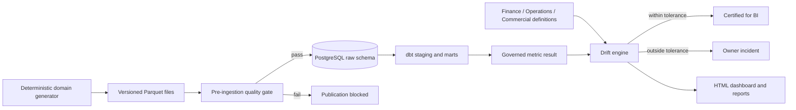

# Semantic Layer & Metric Governance Hub

[](https://github.com/anandh-analytics/semantic-metric-governance/actions)

An executed analytics-engineering project that prevents Finance, Operations, Commercial, and BI teams from publishing different answers under the same KPI name.


## Business problem

Finance recognizes revenue from posted ledger events and refunds. Operations estimates revenue from closed order value. Commercial counts open pipeline as revenue. All three teams call the result “net revenue,” so leadership receives incompatible numbers.

This platform creates one versioned definition, calculates it from governed warehouse facts, compares every team result, and blocks BI certification when drift exceeds policy.

## Executed result

The committed run processed actual generated project data:

| Result | Value |
|---|---:|
| Orders | 50,000 |
| Escrow events | 129,171 |
| Finance transactions | 39,484 |
| Raw quality checks | 9 passed, 0 failed |
| dbt nodes/tests | 20 passed, 0 failed |
| Governed net revenue | $114,211,972.92 |
| Finance drift | 0.0% — certified |
| Operations drift | 15.3% — blocked |
| Commercial drift | 41.8% — blocked |

Evidence: [pipeline summary](reports/pipeline-summary.json), [drift results](reports/metric-drift-results.json), [quality report](reports/data-quality-report.html), and [dbt execution log](logs/dbt-build.log).

## Why this data

The data represents a fictional orders, escrow, and finance organization. It is synthetic by design because KPI conflict is an organizational rules problem and no employer/customer data should be published. The committed Parquet dataset contains 218,655 related business records and is the exact input used by PostgreSQL and dbt.

The fixed seed and [SHA-256 manifest](data/manifests/raw-data-manifest.json) make every source file reproducible and auditable.

## Architecture



## Technology stack

| Layer | Technology |
|---|---|
| Data generation | Python, pandas |
| File storage | Apache Parquet, Snappy compression |
| Warehouse | PostgreSQL 14 |
| Transformation | dbt Core 1.11, dbt-postgres |
| Governance | Versioned JSON registry and threshold policies |
| Quality | Python gates, PostgreSQL constraints, dbt tests |
| Reporting | HTML, JSON, Matplotlib |
| Automation | Make, GitHub Actions |
| Container option | Docker Compose |

## Repository structure

```text
configs/       pipeline and drift policy
dashboard/     generated interactive HTML dashboard
data/          executed raw/processed Parquet and checksums
db/            PostgreSQL DDL and versioned migrations
dbt/           sources, staging, intermediate, marts, and tests
docs/          architecture, catalog, testing, deployment, ADRs, runbooks
logs/          sanitized real pipeline and dbt execution logs
pipelines/     executable end-to-end orchestration
registry/      governed KPI definitions and owners
reports/       generated quality, drift, and run evidence
screenshots/   dashboard output produced by the pipeline
scripts/       isolated local PostgreSQL lifecycle scripts
sql/           source validation and competing team calculations
src/           generator, ingestion, validation, drift, reports, and CLI
tests/         unit, integration, end-to-end, and failure-injection suites
```

## Run the complete project

Prerequisites: Python 3.11+, PostgreSQL utilities, dbt with PostgreSQL adapter, and Make.

```bash
make local-db-start
make pipeline
make integration-test
make test
make local-db-stop
```

`make pipeline` regenerates all committed data, logs, reports, dashboard output, and the screenshot from one execution.

For a container database:

```bash
cp .env.example .env
docker compose up -d --wait
docker compose run --rm pipeline
```

Change the local development password before exposing any service.

## Metric definitions

| Metric | Governed meaning | Grain | Owner |
|---|---|---|---|
| Net revenue | Posted recognized-revenue and refund transactions for closed orders | Date, region | Finance Analytics |
| Closed orders | Canonically closed orders attributed to close date | Date, region | Operations Analytics |
| Average turnaround | Calendar days from open through close; excludes open/cancelled orders | Date, region | Escrow Operations |

See the [full metric catalog](docs/metric-catalog.md) and machine-readable [registry](registry/metrics.json).

## Reliability and controls

- Deterministic data version and file hashes
- Primary/foreign keys and domain constraints
- Pre-ingestion schema, uniqueness, relationship, and value checks
- 15 dbt source/model tests
- Safe expression parser—no arbitrary functions or built-ins
- Metric-specific absolute and relative drift thresholds
- Failure injection proving duplicate orders block publication
- Structured JSON Lines audit log
- Reproducible generated reports linked to one run ID and code revision

## Documentation

- [Business problem](docs/business-problem.md)
- [Architecture](docs/architecture.md)
- [Data dictionary](docs/data-dictionary.md)
- [Metric catalog](docs/metric-catalog.md)
- [Testing strategy](docs/testing-strategy.md)
- [Deployment guide](docs/deployment-guide.md)
- [Metric drift runbook](docs/runbooks/metric-drift.md)
- [Interview explanation](docs/interview-explanation.md)
- [Synthetic-data decision](docs/adrs/001-synthetic-domain-data.md)

## Security and scope

All entities are fictional. No FNF, employer, customer, or personal data is included. Secrets and the local database cluster are ignored. See [SECURITY.md](SECURITY.md).

The PostgreSQL/dbt pipeline was executed locally. Docker Compose is an alternative packaging path; the README does not claim that container path was executed on this machine.

## License

MIT
